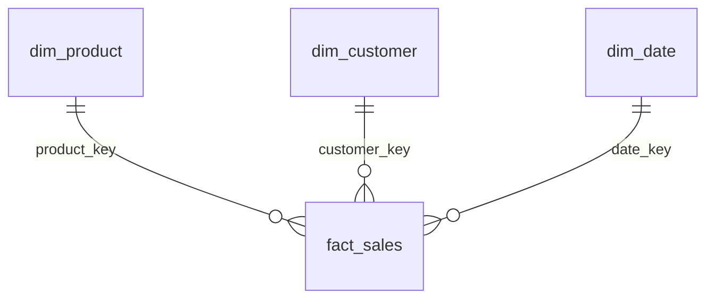

# AdventureWorks Gold: sales star schema

Gold consumes a **SUCCEEDED current eleven-table Silver snapshot**. It does not
read or reset Bronze cursors. Existing Silver contracts/types/transformations are
reused without rewrite. Start with the [local runner](../../local/README.md).

| Delta table | Grain / deterministic key | Purpose |
| --- | --- | --- |
| `dim_product` | `ProductID` as `product_key` | Product number/name and optional category/subcategory |
| `dim_customer` | `CustomerID` as `customer_key` | Individual/store classification, account and territory |
| `dim_date` | YYYYMMDD integer | Continuous min–max observed order-date calendar |
| `fact_sales` | `(SalesOrderID, SalesOrderDetailID)` | Quantity, unit price, discount, gross and net line sales |
| `agg_sales_daily` | date, currency-rate ID | Daily orders/lines, quantity, gross/discount/net |
| `agg_product_month` | YYYYMM, product, currency-rate ID | Monthly product sales |
| `agg_customer_month` | YYYYMM, customer, currency-rate ID | Monthly customer sales |

Dimensions are current-state **Type 1**, with source natural keys as deterministic
keys. A fact key is composite, never a collision-prone hash. Nullable category
hierarchies and store customers without PersonID are preserved with left joins.
No Sales.Store fields are invented: store names are unavailable in the eleven
sources. `person_display_name` is nullable for stores and is personal data; keep
it access-controlled. Metrics/reports never include customer records or names.
Date dimension has one row per calendar day including days without sales; an
empty fact yields an empty calendar. `day_of_week` uses Spark's Sunday=1.

## Measure definitions and scope

- `gross_sales = UnitPrice * OrderQty`, `net_sales = LineTotal`,
  `discount_amount = gross_sales - LineTotal` at order-line grain.
- `LineTotal` stays `decimal(38,6)`; gross/discount use `decimal(28,6)`, enough for
  SQL money × smallint quantities. Narrow intermediate precision avoids Spark
  rounding away the sixth fractional digit during decimal(38,6) subtraction.
- Header SubTotal is reconciled against all its detail lines (tolerance 0.0001,
  matching source money precision). TaxAmt/Freight/TotalDue are deliberately not
  copied into each line: doing that would multiply header amounts. Header-only
  positive subtotals or orphan details block publication. Independently extracted
  header/detail batches must form a consistent Silver snapshot; per-table receipts
  alone do not prove that cross-table invariant. Zero-value headers with
  no lines produce no sales fact.
- All order statuses are retained, with `order_status` in the fact. Aggregates
  describe booked source sales across all statuses, NOT recognized revenue or
  shipped-only revenue. Order counts are distinct inside each group; counts are
  not additive across products/customers.
- Currency conversion is unavailable: CurrencyRate is outside source scope.
  The fact preserves CurrencyRateID and EVERY aggregate groups by it (including
  null), avoiding unjustified conversion/combination of differently identified
  source rates. A rate ID is NOT a currency code. Consumers must not sum these
  buckets as a normalized currency or label amounts USD without evidence. The
  all-row `net_sales` in validation metrics is only a numeric reconciliation
  checksum, not a normalized-currency business KPI.
- No profit/margin is claimed from today's StandardCost: historical cost is not
  in scope. Customer addresses, credit card details and opaque spatial data are
  not copied into Gold. No refunds, CDC hard deletes, SCD2 or FX model is invented.

## Quality and publication

Every required Silver schema/type is checked against the existing eleven-source
contract. All seven outputs are validated before the first business-table write:
null/duplicate keys, invalid monetary/quantity values, fact/dimension FKs, raw
line counts, per-order header subtotals, and aggregate net/quantity totals.
Nullable currency-rate grouping keys use null-safe MERGE equality.

Invalid rows are NOT deduplicated or discarded. Gold rejects the whole snapshot;
error metrics contain counts/reason codes, not raw records. Original Silver rows
remain available for diagnosis, while Silver's existing restricted quarantine
continues to retain rejected source rows and reason codes. Gold audit status is
FAILED and previous published tables are unchanged when preflight quality fails.

Silver Delta versions are pinned for reads, bound to the successful receipt and
latest eleven progress records, then rechecked before publication. The model
code hash, Silver namespace, evidence digest and eleven versions bind a Gold
parent. Model/input drift on the same parent blocks; use an explicitly reviewed
new output namespace for model rebuilds, never edit old success audit records.

Publication compares complete relations first. Identical rows skip MERGE entirely,
so even new parents with unchanged analytical outputs need no business-table
versions. Changed snapshots use Delta MERGE, conditional row-hash updates, inserts
and deletions absent from the current Silver snapshot. This propagates FULL
reference deletions, not missing hard deletes from incremental Bronze extraction.

There is **no seven-table atomic transaction**. `_gold_batches` and
`_gold_progress` provide audit and resumable per-table progress. A commit marker
allows recovery after a Delta write before its checkpoint. Replays of a complete
unchanged parent write neither business nor control tables. Independent target
edits, stale Silver parents, input/model drift and checkpoint loss block adoption.
Consumers must gate multi-table reads on current SUCCEEDED audit; readers cannot
assume an in-flight sequence of table writes is globally atomic. One writer is
required; the local CLI enforces an exclusive lock for its root.

Real AdventureWorks/ADLS, Unity Catalog privileges, Databricks runtime and Azure
execution acceptance remain separate. This package provisions nothing in Azure.
