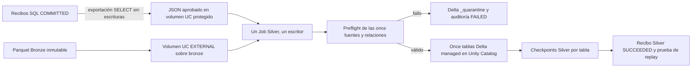

# Fase 3 — Silver con Azure Databricks

Silver en el plan actual; los nombres históricos `phase3` del repositorio describen Bronze. Esta entrega no implementa Gold ni cambia infraestructura, ADF o cursores Bronze.

**Base real informada por el operador:** parent `20d65511-8190-41a0-8ad2-23d7568363d2`, COMMITTED, once cargas, cuenta `stadmmdevdlf6d99ba4`, RG `rg-admm-dev-platform`. PR #17 fusionado. **R2 Bronze en Azure no ejecutada.** Esta entrega añade pruebas locales; no se ha ejecutado ni desplegado Silver en Databricks.

## Arquitectura y frontera de confianza



El Job no conecta a SQL Server local, ejecuta ADF ni necesita contraseñas JDBC. Consume una exportación **real**, producida por `tools/export_committed_parent.py` con un único SELECT de los recibos existentes. El exportador reutiliza únicamente la conexión/diagnóstico Python de Bronze, pide contraseña oculta y comprueba AdventureWorks; no llama procedimientos de escritura ni consulta/modifica watermarks. Nunca se incluye un manifiesto inventado para el parent real en Git.

El JSON contiene parent/fecha/once recibos, texto de los manifiestos y hashes SQL SHA256 sobre UTF-16LE. Silver comprueba el hash agregado del parent en orden de config_id y los hashes, identidad, ruta, modalidad y PK de cada child. Comprueba también conjunto exacto de archivos, tamaños, filas y SHA256 de los Parquet reales antes de leerlos y después de materializar la lectura Spark. No usa globs, `latest`, listados de fechas ni la carpeta de otro parent.

Estos hashes detectan cambios; **no son firmas de autenticidad**. El volumen de evidencias debe admitir escritura exclusivamente al operador confiable que exportó SQL. La identidad Job tiene solo lectura en evidencias y Bronze. No se acepta un parámetro `committed=true` sin los recibos. Las carpetas Bronze deben permanecer inmutables; el Job no modifica sus ETags ni configura permisos.

## Contratos por tabla

`src/admm_silver/contract.json` conserva todas las columnas de negocio y su nullabilidad/tipo. Las once fuentes, PK, modalidades y prefijos proceden de `sql/metadata/002_seed_ingestion_metadata.sql` y `docs/source-contract.md`. Como el repositorio no conserva un perfil físico completo, los tipos provienen del DDL oficial Microsoft fijado por commit y SHA256 en `provenance`. **Es un contrato canónico, no una afirmación de haber inspeccionado los Parquet reales.** El primer Job detectará y bloqueará cualquier incompatibilidad para revisión explícita.

| Fuente | PK de negocio / MERGE | Modalidad | Transformación y controles particulares |
| --- | --- | --- | --- |
| Person.Person | BusinessEntityID | INCREMENTAL | Tipos boolean/entero/XML string; PersonType y EmailPromotion; nombres normalizados adicionales. |
| Person.Address | AddressID | INCREMENTAL | Dirección/código postal conservados, campos normalizados adicionales; FK StateProvince; SpatialLocation opaco string/binario. |
| Person.StateProvince | StateProvinceID | FULL | Flag boolean; nombres/códigos normalizados; FK CountryRegion y SalesTerritory. |
| Person.CountryRegion | CountryRegionCode | FULL | PK textual original, nombre/código normalizado aparte. |
| Production.Product | ProductID | INCREMENTAL | Money decimal(19,4), Weight decimal(8,2), flags; costos/precios/stock/plazos/fechas; FK Subcategory opcional. |
| Production.ProductCategory | ProductCategoryID | FULL | Nombre normalizado; PK única. |
| Production.ProductSubcategory | ProductSubcategoryID | FULL | Nombre normalizado; FK Category. |
| Sales.Customer | CustomerID | FULL | AccountNumber calculado se conserva; FK Person y Territory opcionales; Store queda fuera del alcance. |
| Sales.SalesOrderHeader | SalesOrderID | INCREMENTAL | Money decimal(19,4), boolean, tinyint ampliado a smallint con rango 0–255; fechas, estado y suma TotalDue; FK Customer, Territory y direcciones. |
| Sales.SalesOrderDetail | (SalesOrderID, SalesOrderDetailID) | INCREMENTAL | PK compuesta íntegra; qty/precio/descuento; LineTotal decimal(38,6), tolerancia 0.000001; FK Header y Product. |
| Sales.SalesTerritory | TerritoryID | FULL | Medidas money no negativas; FK CountryRegion; Group conservado como columna escapada. |

TotalDue y los otros campos calculados se preservan desde Bronze; no se recalculan sobrescribiendo el original. Los tipos calculados siguen la aritmética SQL Server: TotalDue money; LineTotal decimal(38,6). Los alias Name/AccountNumber/OrderNumber son string, Flag/NameStyle boolean. SQL geography se conserva opaco, sin inventar una proyección geoespacial. Cambios string/binario entre cargas fallan por drift del destino.

Todas las tablas comprueban columnas exactas (incluidas las nueve de auditoría Bronze), tipos compatibles, cast fallido o redondeo decimal, nullabilidad, UUID, PK nula/duplicada y metadatos de parent/child/modalidad/ventana. **Todas las filas de un grupo duplicado se rechazan**, no se elige un ganador arbitrario. Las normalizaciones `__normalized` solo recortan espacios en campos de nombre/búsqueda; mantienen intactos los valores de negocio y las PK. Las relaciones se evalúan sobre el estado candidato posterior al MERGE, no solo sobre el incremental entrante. No se exige la presencia de tablas fuera de estas once, como Store, SpecialOffer o ShipMethod.

## Tiempo y cursores

- La sesión Spark usa UTC para interpretaciones reproducibles; los datetime SQL son valores de negocio sin zona, no se afirma que el origen los haya registrado en UTC.
- Cada columna temporal conserva un compañero `<columna>__ticks_100ns` entero desde época Unix. El timestamp Delta ofrece microsegundos; el compañero conserva el séptimo dígito para comparación exacta. Timestamps Parquet lógicos en ns se leen como long (`nanosAsLong=true`), comprobando que sean múltiplos de 100 ns. Strings datetime2 de siete dígitos también se preservan.
- Spark trunca INT96 a microsegundos: el preflight Arrow verifica que ningún valor INT96 tenga fracción inferior al microsegundo. Si existe, falla con `INT96_SUBMICROSECOND_UNSUPPORTED`; hace falta una conversión revisada con preservación de ticks antes de soportarlo. No se reescribe Bronze automáticamente ni se declara compatible un formato no observado.
- Las ventanas incrementales son `(ModifiedDate, PK completa)` con límite inferior exclusivo y superior inclusivo; se comprueba que la tupla superior esté presente. Los checkpoints Silver registran límites propios y exigen continuidad exacta. El primer lote incremental debe empezar en `1900-01-01` y PK cero: una ventana aislada posterior no constituye un snapshot inicial.
- Se rechazan parents antiguos y gaps/solapamientos; no se avanza ni reinicia el watermark Bronze. La fecha de orden proviene del recibo SQL, no de la fecha del archivo.

## Delta, idempotencia y fallos

Cada destino se llama `<catalog>.<schema>.<esquema_origen>_<tabla_origen>`, en minúsculas, con todas sus columnas originales y metadatos. Son tablas **managed Delta de Unity Catalog**, sin paths Silver inventados: el almacenamiento lo determina la ubicación managed ya configurada del catálogo/esquema.

INCREMENTAL hace MERGE con PK completa: inserta nuevas claves y actualiza solamente si cambia el hash determinista de negocio. Rechaza regresiones de ModifiedDate para claves existentes. No borra claves ausentes. FULL sincroniza snapshot mediante MERGE con borrado de claves ausentes; un FULL vacío legítimo vacía el destino solo tras superar las relaciones. Un incremental vacío no borra nada ni inventa avance de cursor. No hay deduplicación por timestamp ni `dropDuplicates` sobre datos válidos/rechazados. Las columnas de procedencia de una fila identifican su último INSERT/UPDATE de negocio; una fila sin cambios conserva esa procedencia. El checkpoint/recibo identifica el último snapshot o lote procesado, aunque no haya reescrito filas.

`_silver_progress` guarda último parent, digest, límite y versión Delta por fuente. `_silver_batches` guarda contrato/digest/estado, ejecución del Job, tiempos UTC de inicio/fin, métricas por tabla y error estático. `_quarantine` conserva JSON de contexto original, fuente, parent y reason_codes; se reemplaza solo la partición parent/fuente al reintentar, manteniendo las filas duplicadas. Sus datos pueden contener PII: acceso restringido y retención definida por el propietario; no se imprimen ni se convierten en ejemplos de Git.

Toda la validación de fuentes y relaciones ocurre antes de escribir tablas de negocio. Un fallo de calidad publica cero tablas de negocio, conserva rechazos y registra FAILED. Un fallo técnico **durante** publicación puede dejar algunas tablas actualizadas: Delta no ofrece una transacción de once tablas. El mismo parent puede reanudarse; un marcador de commit Delta permite reconocer una escritura que terminó antes de persistir su checkpoint. Los consumidores deben exigir `_silver_batches.status=SUCCEEDED` para ese parent. No se promete aislamiento multi-tabla para lectores concurrentes.

Un replay de un parent SUCCEEDED verifica su evidencia/contrato y devuelve el recibo sin nuevas escrituras Delta, incluso si después llegaron otros parents. El Job comprueba inmediatamente que repetirlo no altere versiones. No equivale a volver a validar archivos o reconstruir un target borrado. Checkpoints/destinos desaparecidos, esquemas incompatibles, versiones externas o evidencia cambiada requieren investigación, no reset automático.

**Un único escritor por namespace** es obligatorio: Job `max_concurrent_runs=1`, sin modo development que aumente concurrencia, sin otra herramienta que escriba esas tablas. La solución no incorpora un sistema de locks distribuido ni detecta ediciones administrativas que falsifiquen el marcador de commit. Catálogo/esquema separados por ambiente, misma wheel/configuración versionada.

## Configuración mínima y despliegue (no ejecutados aquí)

1. Workspace Azure Databricks con Unity Catalog, runtime **15.4 LTS** (Spark 3.5) en un cluster existente compatible con UC/Volumes y librerías wheel de Job. No se crea cluster/workspace/Access Connector/ADLS ni se cambia Terraform. Elegir identidad Job estable con permisos mínimos.
2. Catálogo/esquema Silver existentes con managed storage configurado. La identidad Job necesita USE CATALOG, USE SCHEMA, CREATE TABLE y SELECT/MODIFY sobre sus tablas propias/control/cuarentena. Otorgar acceso de consumidores solo a tablas aprobadas, no al esquema completo ni a cuarentena; revisar PII/XML/direcciones/códigos de aprobación de crédito antes de ampliar lectores.
3. Volumen **EXTERNAL** UC existente con raíz exacta `abfss://bronze@stadmmdevdlf6d99ba4.dfs.core.windows.net/`, gobernado mediante una storage credential/external location ya autorizada (identidad administrada). Job: USE CATALOG/SCHEMA y READ VOLUME, sin WRITE VOLUME en Bronze. El notebook valida el binding con DESCRIBE VOLUME. No se usan account keys, mounts DBFS ni secretos en Spark config.
4. Volumen de evidencias existente, protegido contra escritura por el Job. Un operador de confianza exporta los recibos SQL COMMITTED y sube el JSON una vez. Esto evita pedir a Databricks conectividad a SQL Server local a través de SHIR, que no es un puente JDBC. Para el parent real, desde Windows/Git Bash, el exportador admite contraseña oculta con `winpty python databricks/silver/tools/export_committed_parent.py --parent-run-id 20d65511-8190-41a0-8ad2-23d7568363d2 --output <archivo-protegido.json> --trust-local-sql-certificate`. La exportación es solo lectura; el usuario existente necesita SELECT de los objetos de auditoría/configuración, no permisos de escritura nuevos. No subir contraseñas ni el `.env`.
5. Configurar autenticación unificada Databricks CLI mediante perfil/OAuth externo al repositorio. En `databricks/silver`, proporcionar `BUNDLE_VAR_catalog`, `BUNDLE_VAR_schema`, `BUNDLE_VAR_existing_cluster_id`, `BUNDLE_VAR_bronze_volume`, `BUNDLE_VAR_receipt_file`. `account` y `parent_run_id` tienen los valores no secretos del contexto; se pueden parametrizar. Dependencias locales de construcción: Python, `build`, CLI Databricks con Bundles. Revisar `databricks bundle validate` y `databricks bundle deploy` como preparación del despliegue; este trabajo no los ejecutó contra un workspace real. El bundle solo declara un Job, notebook y wheel; no incluye infraestructura.

Después de esa configuración única, la validación real se inicia con **un Job** (UI Run now o `databricks bundle run silver`). No requiere once comandos por tabla. El mismo notebook realiza preflight UC, validación de los once manifiestos/Parquet, calidad/relaciones, publicación, métricas y replay de idempotencia.

### Evidencia de aceptación real a conservar

- Job/task SUCCEEDED, salida JSON con once fuentes, input/rejected/target_rows y target_version; replay_verified=true. Ningún parent se marca SUCCEEDED con rechazo.
- `_silver_batches` y once checkpoints con el parent real y su digest; doce o más objetos de control no representan nuevas cargas Bronze.
- Primer snapshot: cada target tiene el conteo reconciliado de su Bronze; ninguna PK nula/duplicada y ninguna relación inválida dentro del alcance.
- Decimal, computed columns, geografía/XML, representación física de UUID/boolean/temporales y precisión real de ADF compatibles con el contrato. Cualquier drift queda bloqueado y se revisa con evidencia antes de cambiarlo.
- Historial Delta sin nuevas versiones al replay. Acceso real UC/ADLS, permisos, networking, instalación de wheel y semántica DBR deben comprobarse en Databricks; las pruebas OSS no los certifican.
- Cargas futuras incrementales usan lower exactamente igual al checkpoint Silver; FULL conserva semántica snapshot. **No ejecutar R2 Bronze como parte de este procedimiento.** R2 Bronze y pruebas reales de cambios incrementales siguen pendientes, con aprobación independiente.

## Pruebas locales y CI

Sin Azure: `python -m pip install './databricks/silver[test]' build`, Java 17 y `python -m pytest -q databricks/silver/tests`. Las pruebas levantan Spark local y usan Delta real con Parquet/recibos sintéticos, no mocks de MERGE. Para entornos con Maven restringido, `tests/download_delta_jars.py <directorio-temporal>` obtiene los dos jars fijados mediante HTTPS y devuelve el valor `SILVER_DELTA_JARS`; conserva proxy/CA. CI usa este camino y Java 17, construye la wheel y compila Python. El bundle también se validó offline contra el JSON Schema de Databricks CLI 0.275.0; eso no sustituye `bundle validate` con el workspace configurado.

Cobertura: sincronía con seed SQL, hashes/rutas/recibos, once esquemas, conservación de negocio/ticks, PK nulas y duplicadas, límite compuesto, decimales, INT96 sin truncado, relaciones, FULL/UPDATE/INSERT/delete, fallo con cuarentena, reanudación tras escritura sin checkpoint, replay sin escrituras y segundo parent sintético con incrementales vacíos. Los JSON sintéticos usan IDs distintos del parent real.

## Límites deliberados

No hay CDC/deletes incrementales, SCD2, Auto Loader, streaming, DLT/Lakeflow ni Gold. Los cambios que Bronze no capture (hard deletes o updates tardíos con el mismo cursor) no pueden reconstruirse en Silver. La base real informada es R1; no se infiere R2 ni una ejecución Silver real.

Verificar SHA256/INT96 desde el driver añade lectura y trabajo por archivo; las relaciones y hashes requieren scans/shuffles. Adecuado para AdventureWorks/portafolio, no un diseño de petabytes. Los duplicados detectados bloquean en lugar de elegir un ganador. Un error de I/O/Parquet ilegible puede registrar solo el error de lote sin filas en cuarentena porque no hay filas decodificables. Los datos sensibles permanecen en Delta/volúmenes restringidos y no en logs. Políticas de retención, máscaras y optimización de archivos deben definirse tras medir la ejecución real, sin inventar infraestructura en este PR.

## Diagnóstico de `committed_evidence`

El operador informó Job Run `11937840542482`, Task Run `831744328908969`,
`SILVER_RUNTIME_FAILED` en `committed_evidence`: el clúster y el notebook sí
iniciaron. No se dispone aquí de la excepción original ni de acceso autenticado
al volumen. **La causa exacta de esa ejecución no está determinada.** No se han
cambiado permisos, rutas, recibos o métodos de acceso basándose en hipótesis.

La etapa realiza exclusivamente estas operaciones, ahora en `admm_silver/evidence.py`:

1. Abrir el recibo en `/Volumes/...` como texto UTF-8 (puede fallar por archivo
   ausente, permisos o E/S).
2. Leerlo y decodificar UTF-8 (puede fallar por E/S o bytes inválidos).
3. Interpretar JSON con rechazo de claves duplicadas (puede fallar por JSON
   malformado o incompleto).
4. Exigir un objeto con `parent_run_id` textual y compararlo con el parent solicitado.

Defecto reproducido: anteriormente `null`, arrays y objetos sin `parent_run_id`
pasaban el parser JSON y provocaban `TypeError`/`KeyError` al indexarlos. Ahora se
rechazan con `RECEIPT_OBJECT_REQUIRED` o `RECEIPT_PARENT_REQUIRED`. Esto demuestra
un defecto de validación, **no que el recibo real tenga esa forma**. No se reparan,
truncan ni sustituyen archivos. La validación completa COMMITTED, once tablas,
hashes y manifiestos sigue en `pipeline.run`, antes de publicar datos Silver.

El manejador del notebook emite un único JSON con `stage`, `error_code`,
`error_type` y `location` (archivo relativo del paquete y línea exacta). Conserva
`SILVER_RUNTIME_FAILED` como prefijo para excepciones inesperadas, añade ese mismo
JSON seguro al error de la tarea (además de la salida de celda) y suprime el encadenamiento
del error. Ejemplo de **formato ilustrativo, no evidencia de Databricks**:

```json
{"status":"FAILED","stage":"committed_evidence","error_code":"RUNTIME_FAILED","error_type":"PermissionError","location":{"file":"admm_silver/evidence.py","line":8}}
```

Se registra solo la ubicación más interna de código del paquete, no la traza
completa. No se imprimen mensajes originales, rutas del recibo, JSON, filas,
variables locales, credenciales ni rutas absolutas de instalación. Si el fallo
ocurre fuera del paquete, `location` será `null` en lugar de exponer rutas ajenas.
Los errores de contrato conservan códigos estáticos; mensajes no conformes se
ocultan. Los diagnósticos son salida del notebook: una etapa que falla antes de
`pipeline.run` no inventa una auditoría Delta ni escribe datos para registrar el error.

Las pruebas locales incluyen E/S denegada/ausente/fallida, UTF-8 inválido, JSON
malformado, claves duplicadas, estructuras inválidas y ejecución del manejador
real del notebook con dependencias simuladas. Comprueban que no se inicia
`pipeline.run` tras el fallo y que los datos privados no aparecen en el diagnóstico.
No prueban permisos ni existencia de un archivo real en Unity Catalog.

No se requiere ejecutar Silver para revisar este PR. Antes de autorizar cualquier
nuevo intento, revisar código y pruebas. Si posteriormente se autoriza un nuevo
run con esta versión, el JSON de salida de la tarea permitirá distinguir la
operación y el tipo exacto de fallo; no hace falta habilitar trazas completas ni
compartir el contenido del recibo.
